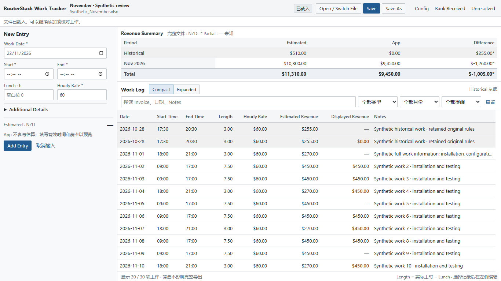

# RouterStack Work Tracker

## Project Overview

RouterStack Work Tracker is an offline-first personal tool for recording work, estimating revenue, comparing amounts shown in the RouterStack app, and carrying unresolved items into the next work period. It is not official RouterStack software, an accounting system, or a payroll system.

Application version: **0.1.0**. Workbook schema: **5.0**. Calculation version: **3.0**. These versions describe separate concerns; the application version does not change the workbook format or calculation rules.

*Desktop workbench with synthetic data.*

## Core Features

- Continuous work entry with optional Invoice, App amount, Extra, and Notes.
- An eight-column Work Log with Current and Historical records, search, filters, and Compact / Expanded views.
- Revenue Summary by Historical records, current work months, and Total, preserving the distinction between an unknown App amount and an explicit zero.
- Editable calculation settings with a preview before applying changes to Current records; Historical records retain their original rules.
- Independent bank receipts, manual issues, and explicitly confirmed balances.
- Selective carry-forward of unresolved items and their necessary source records and history.
- Explicit Save / Save As, external-file conflict detection, and draft protection when saving fails or is cancelled.

## Technology Stack

- Plain HTML, CSS, and JavaScript, loaded as classic scripts.
- Bundled JSZip for local XLSX ZIP/XML processing.
- IndexedDB for a recent-file reference only.
- Node.js for development scripts and unit tests; Playwright for browser tests.
- PowerShell and installed desktop Excel for optional Excel compatibility verification.

There is no build step, backend, database of work records, or runtime network dependency.

## Getting Started

Download or clone the repository, keep its directory structure intact, and open [index.html](index.html) in desktop Chrome or Edge. Opening the HTML file directly works offline and requires no Node.js installation, server, account, or macros.

For development, install Node.js **22 or later** and run:

~~~sh
npm ci
npx playwright install chromium
npm run dev
~~~

Open http://127.0.0.1:4173. Dependency and browser installation require internet access; daily application use does not. CI uses Node.js 24. In Windows PowerShell, use `npm.cmd` / `npx.cmd` if execution policy blocks the corresponding PowerShell wrappers.

## How to Use

1. Open your latest retained schema 5.0 XLSX, or start with the empty workbook shown at launch. An identity-free [blank template](templates/RouterStack_Tracker_V5_Blank.xlsx) is also included.
2. Enter the actual date, start/end times, and hourly rate. Lunch is a number of hours; a blank Lunch counts as zero. Invoice and other details can be added later.
3. Review the Work Log and Revenue Summary. Select a row to edit it in the left panel. Expanded view displays full Notes. Use the Config, Bank Received, and Unresolved drawers when needed.
4. Use **Save** to write the current permitted file, or **Save As** to create a new working copy. If the browser uses a download, explicitly confirm that you retained the downloaded file.
5. After saving the current file and submitting or cancelling drafts, open carry-forward from Unresolved. Choose reminders, manual issues, and confirmed balances, generate the next-period XLSX, then open that file to continue.

An App difference is not a confirmed debt. A bank total does not establish payment of an individual Invoice. Bank receipts, manual reference amounts, and confirmed balances do not enter Revenue Summary.

## Data Storage & Privacy

The latest XLSX you explicitly save and retain is the **sole persistent source of work data**. The Tool is the **only business-editing interface**. Excel may view, recalculate, sort whole tables, filter, and save; external edits to business values, Config, identities, histories, or formulas are rejected on import.

Drafts and added entries stay in memory until saved. A failed or cancelled save preserves them. Starting a download does not prove that a file was retained, and confirming an older download does not clear newer edits.

The optional recent-file entry stores only a file handle, name, and write capability in IndexedDB. It stores no workbook bytes or work records. Browser permissions can expire, and moved files may need to be selected again. Direct file access depends on browser support and user permission; the file-input/download fallback remains available.

The application has no API calls, analytics, remote storage, or automatic uploads. Keep real workbooks and financial documents outside the repository and maintain your own backups. Tests generate synthetic data only.

## Development & Testing

Run these commands from the repository root:

| Command | Purpose |
|---|---|
| `npm run dev` | Serve the local development copy on loopback port 4173 |
| `npm run check` | Check JavaScript syntax, embedded-template synchronization, and Node tests |
| `npm test` | Run calculation, model, summary, and carry-forward unit tests |
| `npm run test:e2e` | Run offline browser workflows, data-integrity checks, and desktop UI tests |
| `npm run test:native` | Check native file references and permission fallback across a browser restart |
| `npm run test:excel` | Run Windows desktop Excel recalculation, sorting/filtering, save/reopen, and two carry-forward cycles |
| `npm run capture:desktop` | Generate synthetic desktop screenshots and measurements under `playwright-report/` |
| `npm run template:generate` | Regenerate the blank schema 5.0 workbook and synchronize its embedded asset |
| `npm run template:sync` | Refresh the embedded asset from the existing blank workbook |
| `npm run template:check` | Check template/embedded-asset consistency without modifying files |

For the browser suite, set `TEST_BROWSER` to `chrome` or `msedge` to use an installed browser channel. The native-file and screenshot scripts use Playwright Chromium. Excel verification requires Windows PowerShell and installed desktop Excel; it is not part of the Linux CI job.

CI runs `npm run check`, `npm run test:e2e`, and `npm run test:native`. A local pass does not establish a remote CI result or a release. Browser tests cover real downloads and reopening; controlled handles cover write failures and conflicts. Native-handle and desktop Excel checks have separate scopes. Required checks by change type are defined in [AGENTS.md](AGENTS.md).

## Project Structure

~~~text
.github/workflows/       CI configuration
docs/
  PROJECT_GOAL.md        Product goals and scope (Chinese)
  architecture.md        Architecture and XLSX contract (Chinese)
  roadmap.md             Maintenance and release direction (Chinese)
  images/                Documentation screenshots
scripts/                 Local development, template, and verification tools
src/                     Application code, styles, and embedded blank template
templates/               Identity-free schema 5.0 blank XLSX
tests/
  browser/               Playwright tests and shared browser helpers
  *.test.mjs             Node unit tests
  fixtures.mjs           Synthetic unit-test fixtures
vendor/                  Bundled JSZip and its license
AGENTS.md                Contributor/Codex operating constraints (Chinese)
index.html               Offline application entry point
~~~

Local workbooks, backups, and generated test artifacts are ignored by Git.

## Architecture Overview

`core.js` provides calculation rules. `model.js` owns validated WorkbookState operations. `workbook.js` reads and writes the four-sheet, eight-table XLSX. `reports.js` derives summaries, while `app.js` and `review-ui.js` connect the model to the desktop interface. `recent-file.js` manages the optional file reference.

The workbook contains Work Log, Config, Follow-up, and History sheets. Detailed fields, formulas, integrity limits, and save/carry-forward semantics are defined once in the [architecture and data contract](docs/architecture.md).

## Known Limitations

- Desktop only, with acceptance viewports of 1366×768 and 1920×1080. The interface uses Chinese labels alongside English work and finance terms.
- Only schema 5.0 / calculation 3.0 is accepted. Schema 2.0–4.1 files are rejected; no migration or legacy reader is provided.
- Direct file writes and recent-file permissions vary by browser and session. Do not rely on permanent permission or automatic saving.
- The calculation model is an editable estimate, not a statement of official rates or payment policy. Clock-time shifts must be shorter than 24 hours; no daylight-saving elapsed-time or holiday-specific model is provided.
- The workbook has explicit file, XML, and Excel-row limits. Compatibility and performance are bounded by the cases actually verified, not every Excel version or its theoretical row capacity.
- External business editing, cross-file merging, bank/App integration, cloud sync, and automatic payment allocation are outside the current scope.

## Documentation

Read in this order:

1. [README.md](README.md): project entry, use, and development.
2. [Project Goal](docs/PROJECT_GOAL.md): product objectives and business boundaries.
3. [Architecture](docs/architecture.md): current implementation and XLSX data contract.
4. [Roadmap](docs/roadmap.md): maintenance and future work boundaries.
5. [AGENTS.md](AGENTS.md): contributor/Codex constraints and required verification.

Product scope is defined by Project Goal; data behavior by the architecture contract; development procedure by AGENTS.md. See [LICENSE](LICENSE) for the MIT license and [JSZip's bundled license](vendor/JSZip_LICENSE.markdown) for the third-party dependency.
